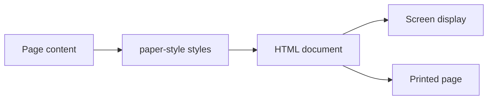
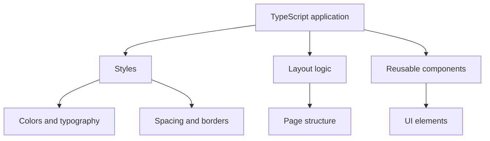
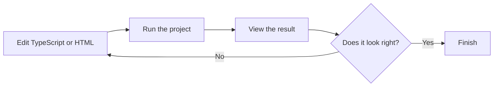

# paper-style

paper-style is a TypeScript project that turns web content into clean, paper-style layouts. It provides reusable styling and components so pages look organized and easy to read on both screens and printed pages.

## What you can use it for

- Give articles and documents a clean paper-like appearance
- Reuse consistent typography and spacing
- Print long-form content with predictable layouts
- Turn HTML content into a polished reading experience

## How it works

The project follows this simple flow:



## Main pieces



## Getting started

### 1. Install dependencies

```bash
npm install
```

### 2. Start the project

```bash
npm start
```

> Use the scripts in `package.json` if your project provides a different start or development command.

## Development flow



## Project structure

Your repository may contain folders such as:

- `src/` — TypeScript source code
- `public/` — HTML and public assets
- `package.json` — project scripts and dependencies
- `tsconfig.json` — TypeScript settings

## Technology

- **TypeScript** — main application language
- **HTML** — page structure
- **CSS or TypeScript-generated styles** — visual appearance

## Contributing

1. Clone the repository.
2. Create a separate branch.
3. Make and test your changes.
4. Open a pull request.

## License

Add your license information here.
